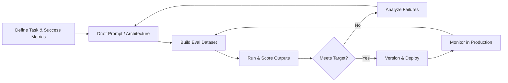

<!-- ========================= HEADER BANNER ========================= -->
<div align="center">


<a href="https://github.com/YOUR_USERNAME">
  
</a>

<br/>

<a href="https://www.linkedin.com/in/thejas-gowda-26b202340"></a>
<a href="mailto:tejasgowdahr09@gmail.com"></a>

<a href="https://YOUR_PORTFOLIO.com"></a>
<a href="https://huggingface.co/YOUR_HF_USERNAME"></a>
<a href="https://www.kaggle.com/YOUR_KAGGLE_USERNAME"></a>

<br/><br/>


</div>

---

## 👨‍💻 About Me

I'm **H R Thejas Gowda**, a **3rd-year B.Tech student in Computer Science Engineering (AI/ML)** at **Amity University Bengaluru**.

I'm building my career across **AI engineering, prompt engineering, software development and web development**, and I'm also a **graphic designer**, so I like projects where solid engineering meets a clean, well-designed experience. I'm a **Core Member of the AWS Club**, where I learn and build with cloud technologies alongside my peers.

```python
class Thejas:
    role        = ["AI Engineer", "Prompt Engineer", "Software & Web Developer", "Graphic Designer"]
    education   = "B.Tech CSE (AI/ML) · 3rd year · Amity University Bengaluru"
    community   = "Core Member · AWS Club"
    focus       = ["LLM Applications", "RAG Systems", "Full-Stack Web", "Prompt Evaluation", "UI & Visual Design"]
    principles  = ["Measure before you optimize", "Prompts are code: version and test them", "Design is part of the product"]
    currently   = "Building LLM workflows, web apps and cloud skills while still studying"
    open_to     = ["Internships", "Open-source collaboration", "AI / Web / Design projects"]
```

---

## 🎯 What I Do

<table>
<tr>
<td width="50%" valign="top">

### 🧠 AI Engineering
- Building LLM-powered apps and APIs
- Retrieval-Augmented Generation (RAG) pipelines
- Tool-using agents and multi-step workflows
- Model training, fine-tuning and evaluation

</td>
<td width="50%" valign="top">

### ✍️ Prompt Engineering
- System prompt and instruction design
- Few-shot, chain-of-thought and structured-output prompting
- Prompt testing, versioning and regression suites
- Reducing hallucinations with grounding and constraints

</td>
</tr>
<tr>
<td width="50%" valign="top">

### 💻 Software & Web Development
- Full-stack web applications
- Clean, maintainable Python and JavaScript code
- REST APIs and backend services
- Git-based workflows and collaboration

</td>
<td width="50%" valign="top">

### 🎨 Graphic Design
- Social media graphics, posters and event branding
- Presentations and visual identity with Canva
- UI-minded layouts and consistent design systems
- Turning ideas into clear, polished visuals

</td>
</tr>
</table>

---

## 🛠️ Tech Stack & Skills

**Languages & Core**


**AI / ML & LLMs**


**Web Development**


**Cloud, Data & DevOps**


**Design & Creative Tools**


<!-- Add your other design tools here, for example Figma, Photoshop, Illustrator, CapCut. -->

---

## 🔄 My LLM Development Workflow



---

## 📌 Featured Projects

> Replace each block with your real project details and links.

| Project | Description | Stack | Links |
|---|---|---|---|
| **🔎 Project One: RAG Assistant** | Document Q&A system with retrieval, re-ranking and cited answers | `Python` `LangChain` `FAISS` `FastAPI` | [Repo](https://github.com/YOUR_USERNAME/project-one) · [Demo](#) |
| **🤖 Project Two: AI Agent** | Tool-using agent that plans, calls APIs and verifies its own results | `Python` `LLM APIs` `Docker` | [Repo](https://github.com/YOUR_USERNAME/project-two) · [Demo](#) |
| **🌐 Project Three: Full-Stack Web App** | Responsive web application with a backend API and a clean UI | `React` `Node.js` `Tailwind CSS` | [Repo](https://github.com/YOUR_USERNAME/project-three) · [Demo](#) |
| **🧪 Project Four: Prompt Eval Kit** | Lightweight framework to version, test and score prompts against datasets | `Python` `Pandas` `Streamlit` | [Repo](https://github.com/YOUR_USERNAME/project-four) · [Demo](#) |
| **📊 Project Five: ML Model** | End-to-end model with data pipeline, training and evaluation report | `PyTorch` `scikit-learn` `Jupyter` | [Repo](https://github.com/YOUR_USERNAME/project-five) |

---

## ✍️ Prompt Engineering Showcase

<details>
<summary><b>Example: structured, production-style system prompt</b> (click to expand)</summary>

```text
# ROLE
You are a precise technical assistant for {domain}.

# CONTEXT
Use ONLY the information inside <context> tags to answer.
If the answer is not in the context, reply exactly: "I don't have enough information."

# TASK
Answer the user's question in at most 5 sentences.

# OUTPUT FORMAT (JSON)
{
  "answer": "<string>",
  "confidence": "high | medium | low",
  "sources": ["<doc_id>", "..."]
}

# RULES
- Never invent facts, names or numbers.
- Cite a doc_id for every factual claim.
- Think step by step internally; output only the final JSON.
```

</details>

<details>
<summary><b>Techniques I work with</b></summary>

- **Zero-shot / few-shot prompting** with carefully chosen examples
- **Chain-of-thought and self-consistency** for reasoning-heavy tasks
- **Structured outputs** (JSON schemas) for reliable downstream parsing
- **Role, context and constraint separation** using clear delimiters or XML tags
- **Grounding and citation** to reduce hallucination in RAG systems
- **Prompt chaining and routing** for multi-step workflows
- **Evaluation-driven iteration** with datasets, rubrics and LLM-as-judge

</details>

---

## 🎨 Design Work

I design graphics, posters, social media creatives and presentations using **Canva** and other creative tools.

> Add links to your design portfolio (Behance, Canva public links, Google Drive, Instagram) and a few sample images here.

| Sample | Link |
|---|---|
| 🖼️ *Poster / event branding* | [View](#) |
| 📱 *Social media creatives* | [View](#) |
| 📽️ *Presentation design* | [View](#) |

---

## 📊 GitHub Analytics

<div align="center">


</div>

---

## 🌱 Currently Learning & Exploring

- 🔹 Advanced RAG: hybrid search, re-ranking and evaluation
- 🔹 Agentic workflows and tool use
- 🔹 Full-stack web development and modern frontend frameworks
- 🔹 Cloud fundamentals and deployment on AWS
- 🔹 LLM evaluation and observability
- 🔹 Fine-tuning small language models (LoRA / QLoRA)

---

## 🏆 Certifications, Community & Achievements

- ☁️ **Core Member, AWS Club**: certificate received · [View certificate](#)
- 🎓 *Add other certifications*: Issuer (Year)
- 🥇 *Add hackathons / competitions*: Result (Year)
- 📝 *Add publications / blog posts*: Title and link

---

## 🤝 Let's Connect

I'm a student open to **internships, collaborations and AI, web or design projects**. If you're building something interesting, I'd love to hear about it.

<div align="center">

[](https://www.linkedin.com/in/thejas-gowda-26b202340)
[](mailto:tejasgowdahr09@gmail.com)


<br/>


</div>
